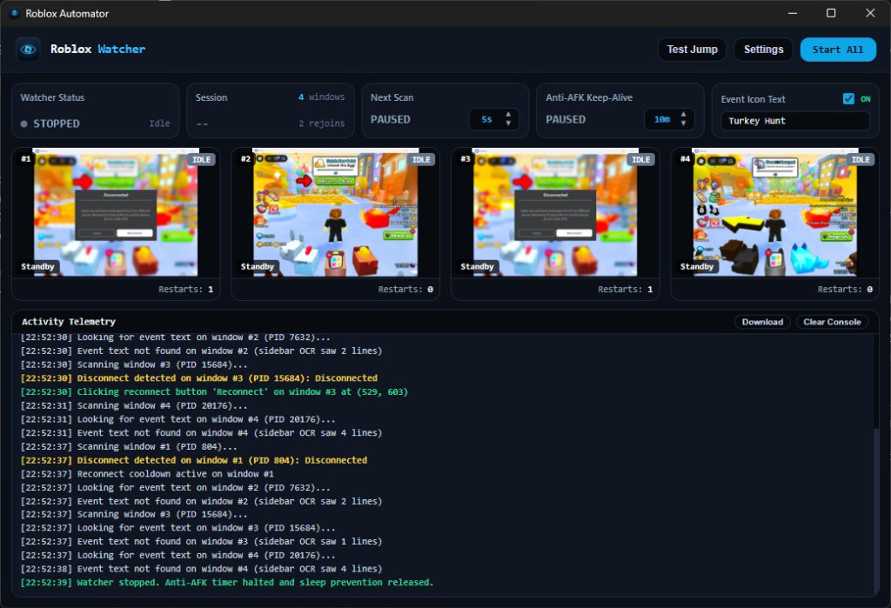

# Roblox Automator

A lightweight Windows companion app that keeps your **Roblox** accounts online 24/7 — preventing idle kicks, reconnecting automatically after disconnects, clicking sidebar event buttons, and replaying recorded macros across every game window.

---

## Key Features

- **Anti-AFK (20-Minute Kick Prevention)**  
  Periodically performs a quick character jump across each monitored Roblox window before Roblox's 20-minute idle timer expires, then immediately restores your previous window focus and mouse cursor position.
- **Automatic Reconnect**  
  Monitors every running Roblox window in the background for disconnect dialogs, server shutdowns, and connection errors (e.g. `277`, `279`, `529`), then automatically clicks **Reconnect** / **Retry** — including non-English Roblox clients (*Połącz ponownie*, *Reconectar*, *Erneut verbinden*, etc.).
- **Smart Click**  
  Watches the left UI panel for a custom button or event label (such as *Turkey Hunt*) and automatically clicks its exact center whenever it appears.
- **Macro Recording & Multi-Window Replay**  
  Record keystrokes, mouse movements, clicks, and scroll actions directly in one Roblox window — **on par with TinyTask, and even better**: instead of being tied to a single window, Roblox Automator automatically normalizes window sizes and replays your recorded sequence in **every** Roblox window after a reconnect or Smart Click.

---

## Additional Features

- **Live Multi-Window Preview Grid**: Displays live thumbnail previews, connection health badges, restart counters, and zoomed click-target overlays for all active Roblox windows.
- **Uniform Window Sizing**: Automatically keeps monitored Roblox windows at a consistent size (`800×600`) so UI layouts and macro coordinates match across every account.
- **Sleep & Screen-Lock Prevention**: Keeps Windows awake and prevents the display from turning off or locking while automation is active.
- **Activity Telemetry & Logs**: Real-time color-coded console with one-click **Download** (`roblox-automator-logs.jsonl`) for troubleshooting.

---

## Getting Started

1. Download **`Roblox-Automator-v....zip`** from the [Releases](../../releases) page and extract it.
2. Open one or more Roblox windows.
3. Launch **`roblox-automator.exe`**.
4. Click **Start All** to begin monitoring and Anti-AFK protection.

### Tips
- **Anti-AFK Interval**: Adjust the keep-alive interval (default: every `10` minutes) directly from the **Anti-AFK** card.
- **Scan Interval**: Adjust how often windows are checked (default: every `15` seconds) from the **Next Scan** card.
- **Macro Recording**: Select a target window, click **● Rec**, wait for the `3… 2… 1` countdown, perform your sequence, and move the mouse outside the Roblox window to stop.
- **Settings**: Open **Settings** in the top-right to customize disconnect keywords, reconnect button phrases, or cooldown timings.

---

## Community & Support

Need help, want to share setups, or chat with other users?  
Join our Discord server: **https://discord.gg/ce5yGvTf9**

---

## Code Signing Policy

Free code signing provided by [SignPath.io](https://signpath.io/), using a certificate by [SignPath Foundation](https://signpath.org/).
